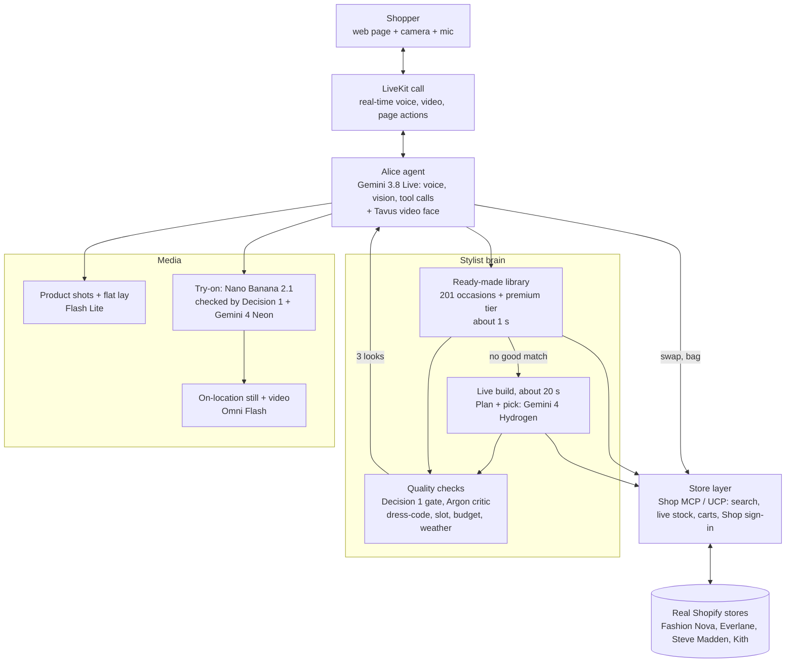
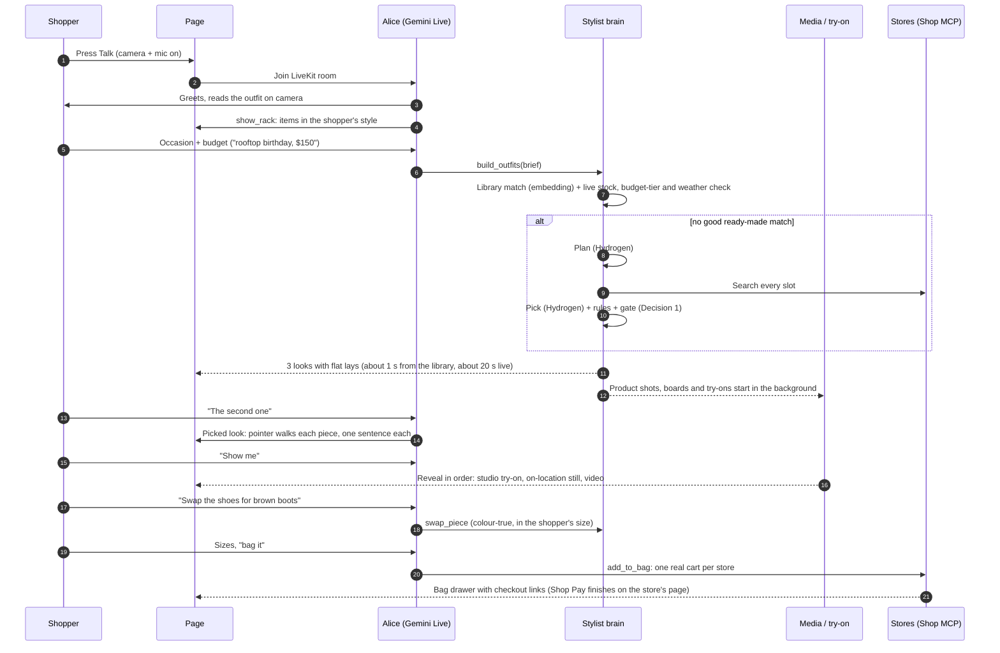

# How Alice works

Alice is a live video AI stylist. She builds outfits from real Shopify stores, shows them on you, and hands you real carts. Live during judging at https://alicestyles.me.

## 1. System architecture

The page also works without a call: a storefront of real products, an occasion picker (dropdown + word search over the ready-made library), and buttons to add a look to the bag or remove a piece (`POST /api/bag`).

## 2. One call, step by step

## 3. Models and their jobs

| Model | Job in Alice |
| --- | --- |
| Gemini 3.8 Live | The whole conversation: voice in and out, reads the camera, calls the tools |
| Gemini 4 Hydrogen | The stylist: plans 4 outfit ideas and picks every real product |
| Gemini 4 Argon | The critic: scores every look 1-10 from product photos and names the weak piece; grades the ready-made library; judges the eval |
| Gemini 4 Neon | Try-on inspector: says what is wrong with a failed try-on so it can be re-rendered (also wrote the code through Antigravity) |
| Decisions API (gemini-decision-1) | Fast yes/no gates: does the outfit fit the occasion and hang together; is the try-on the same person with the right pieces |
| Gemini 3.5 Flash Lite | Backup planner, picks the cleanest product photo, rewrites a look's lines after a swap |
| Nano Banana 2.1 | Try-on image and on-location still: the shopper wearing the look |
| Omni Flash | The short try-on video in the event's setting |
| Gemini Embedding 001 | Matches what the shopper says to a ready-made occasion |
| Shop MCP (UCP) | Real Shopify catalog, live stock, real carts, Shop sign-in |
| LiveKit / Tavus | Real-time call transport / Alice's video face |

Alice's tools: `build_outfits`, `pick_outfit`, `show_on_me`, `swap_piece`, `search_products`, `show_rack`, `show_product`, `hide_product`, `show_all_looks`, `add_to_bag`, `remove_from_bag`, `set_department`, `remember`, plus `review_order` and `place_order` only when in-call purchase is switched on.

## 4. Answers for judges

- **How fast is it?** Measured on a call at 2:38 PM: first look about 1 s from the ready-made library (201 occasions plus a premium tier, built today with the same pipeline and graded by Argon); a live build for anything else takes about 15-21 s while Alice keeps talking. Try-on is ready about 24 s after the looks appear, the on-location still at the pick, the video about 30 s after the pick, and the bag in 1.5-2 s.
- **How do you know the outfits are good?** An eval on 22 occasions, every look graded by Argon (`eval/results/RESULTS.md`): the pipeline averages 6.1 against 5.1 for a one-call baseline, with 13/22 vs 3/22 presentable sets, 0 dress-code breaks vs 4, and 0 over-budget outfits vs 21.
- **Can Alice buy for me?** In the call Alice signs the shopper in to Shop (tested today with a real account) and builds the real store checkout with their saved address. Fashion Nova and Steve Madden then require their own checkout page (the store says "An extension interaction is required"), so Alice hands over the link and Shop Pay finishes there. No in-call order has completed at a real store yet; Everlane and Kith are untested.
- **Managed Agents?** A capsule packer is built and measured: a Gemini Managed Agent in a Google sandbox plans a multi-day trip with a real solver and a certificate (packing about 24 s, re-planning 30-40 s, 4-6 cents). It is on main but switched off, and nothing in the call uses it.
- **Where does it break?** Men's black tie (the stores carry only one solid tie; the classic suit look now scores 8/10), some women's formal interviews, briefs like "X then Y", and in-call payment (above).
- **Are the products real?** Yes. Four real Shopify stores through Shop MCP, live stock and price checked when served, and real carts with checkout links.
- **What stops bad looks?** Hard rules (no white at weddings, no novelty ties at formal events, every piece in its own slot, the budget), the Decisions gate, the Argon critic, and a weather filter when the date and place are known.
- **Swaps?** Colour-true ("brown boots" come back brown), cheaper and same-type rules, and in stock in the shopper's size, or Alice says so plainly.
- **Safety?** A separate session attacked the server, the store client and the purchase code all day; every finding is fixed on main, and the purchase code was re-run against its harness before each merge (49 cases at the end). No payment without a Shop sign-in, an on-screen tap and a spoken yes; one order attempt per call; secrets masked in the logs.
- **Who built what?** Four tracks: agent and persona, outfits (stylist brain, ready-made library, eval), back end (stores, media, try-on, server), front end. Most code was written by Antigravity on Gemini 4 Neon from briefs, with Claude Code sessions writing the briefs and checking the work (the first Outfits code in the morning was written by Claude Code directly).
